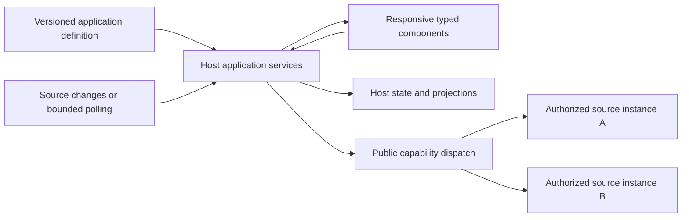

# Composable applications

**Architecture requirement, recorded 16 October 2026.** OpenAgent must support
composing persistent, interactive applications from independently supplied
tools, data sources and UI components. Multiple accounts of one provider and
multiple providers must be usable in the same application. This document
defines the extension boundaries and acceptance criteria; it does not announce
a shipped application framework or implement the reference applications.

The reference cases are a calendar over several accounts, a task tracking
system, and document management over several filesystems with editing. They
test the architecture's generality. Their provider tools and domain behavior
remain independent integrations; none is required by Core or added by this
decision.

## Composition and ownership

An application assembles a versioned definition, data bindings, actions, views
and lifecycle policy. It can be created by a developer or an authorized agent.
Its ordinary interactions must execute deterministically without requiring a
model turn for every click, keystroke, refresh or synchronization step. Agent
reasoning remains available when the interaction calls for it.

| Layer | Responsibility | Boundary |
| --- | --- | --- |
| Core | Verified execution context, authorization, capability discovery and dispatch, durable runs and optional modules | Public contracts; no dependency on a particular UI, provider or standalone identity |
| Tools and connectors | Provider/file operations, schemas, feature discovery and source-specific change semantics | Same adapters for every consuming host; no application layout or product accounts |
| Application services | Definitions, bindings, domain state, projections, action records and synchronization lifecycle | Host-owned storage and authorization; independently testable, optional services |
| Presentation | Component registry, navigation, responsive layout, forms, selections, editor buffers and accessibility | Typed data/action bridge; no provider tokens or direct privileged execution |
| Host | Authenticated identities, grants, secrets, storage, worker limits and installed component versions | Explicit construction and shutdown; no central OpenAgent account dependency |

This architecture places application services alongside the standalone's existing dashboards.
Embedding hosts can supply their own services and renderers using the same
public capability boundaries. Reusable services can be extracted into versioned
packages when their contracts are qualified. This decision adds no required
kernel module, source overlay, new central service or adopter-specific code.

## Contracts to preserve

The following names describe architectural roles. They are not new configuration
keys, callable endpoints or a published wire schema.

### Application definition and component registry

A definition identifies its schema version, immutable revision, component
dependencies, required capabilities, named source slots, views, actions and
state migrations. It stores references to grants rather than credentials.
Importing a definition never imports another person's access. The receiving
host resolves each source slot with its own authorized configuration.

Components declare typed properties, outputs, interaction events and supported
renderer versions. Layout and data adapters are independent: changing a source
does not require rewriting a view, and changing a view does not change an
operation's permissions. Collections, relations, selection, navigation,
validation, drag operations and text editing must be expressible through
composable contracts rather than a fixed set of provider-specific screens.

The renderer registry must admit versioned extensions with explicit host
installation and compatibility checks. A portable subset must have defined
fallbacks when a renderer is unavailable. Responsive layouts retain access to
data and actions on narrow screens; keyboard operation, focus, loading, empty,
partial, stale and error states are part of the component contract. CLI and
non-graphical hosts use the same application services without pretending to
render a graphical editor.

An application definition cannot add executable JavaScript, arbitrary native
code or new privileges merely by naming a component. Trusted renderer code and
explicitly configured command capabilities retain their existing installation
and execution policy. View content is data, not authorization.

### Source bindings and resources

A provider name is not a connection identity. Each binding resolves to a
specific installation, tenant, principal/grant, connection, executor and
resource scope. Two accounts of the same provider are distinct sources, as are
two computers exposing the same filesystem tool. Source slots and display
names never let an action substitute another account or device.

A resource reference preserves its source identity, provider-native identifier,
type and available version token. File references also preserve filesystem/root
identity; paths are interpreted only by their bound executor. Names and paths
alone are insufficient global identifiers. Copies across sources receive new
identities and explicit provenance rather than silently becoming one object.

Bindings declare schemas for reads, mutations, relationships, pagination,
changes and errors, and advertise which features are actually supported. The
application can compose typed projections while retaining source attribution
and domain semantics, such as time zones, ordering, text encoding or binary
content. It must not flatten every provider into a lossy universal record.
Unsupported features have explicit capability results and UI states.

Collection queries need typed filtering, sorting, pagination and bounded
incremental delivery, with their actual source limitations exposed. Large
collections and file contents must be loaded on demand rather than copied
wholesale into the model context or renderer. Query parameters cannot alter
the binding's identity or resource grant.

Combining sources does not combine their permissions. Reads, joins, search,
counts, exports and subscriptions must authorize both input resources and the
result audience. One authorized source cannot reveal another's contents or
metadata. Partial results identify unavailable sources only to an audience
already permitted to know those bindings.

### Actions and durable state

Every action binds its target source, validated input/output schemas, required
permissions, execution location, expected resource version and applicable
idempotency policy. The host resolves current capabilities at execution time;
persisted definitions never retain an expired opaque ToolRef or client lease.
UI, CLI and agent invocation converge on the same service and authorization
path. A read-only view does not imply permission to mutate its backing source.
Shared services do not automatically advertise App-only tools to other channels
or background runs; the host still selects and authorizes each surface.

State has separate lifecycles:

| State | Authority and persistence |
| --- | --- |
| Definition and view revision | Immutable, checksummed configuration with explicit migrations |
| Application-owned records | Durable host data with ACLs, versions, backup and recovery |
| Source projection/cache | Derived data with provenance, cursor, freshness and rebuild procedure |
| Pending mutation and outcome | Durable intent and reconciliation record; never a cache |
| UI state | Selection, navigation and drafts scoped to the user/device; durability declared explicitly |

Saving a view or publishing a new layout must not reset records, drafts or
synchronization checkpoints. Rebuilding a cache must not discard unsent edits.
A locally persisted projection is not evidence of a successful provider write.
Attachments use authorized content references rather than exposed host paths.

Actions that span providers are not a distributed atomic transaction. Each step
records its outcome; partial completion is visible and recovery or compensation
is explicit. Writes with an ambiguous outcome are reconciled before another
attempt. Provider-supported idempotency and conditional updates are used where
available; application code must not promise exactly-once external effects.

### Synchronization and background work

Synchronization is a lifecycle owned by the host application service, not by an
open chat transcript or a visible component. Each source/resource partition
has independent checkpoints, ordering/version semantics and health. Webhooks,
change streams and bounded polling are interchangeable only where the source's
declared contract permits it. One failed account does not block healthy ones.

The synchronization contract must specify initial pagination, incremental
updates, deletion/tombstones, duplicate and out-of-order delivery, cursor expiry,
full rescan, rate limits and restart recovery. Checkpoint advancement and local
projection changes commit consistently. Durable jobs deduplicate delivery and
bound retries, concurrency, memory, disk and retention. Idle sources must not
create a polling storm; subscriptions can share work only within compatible
authorization and resource boundaries.

Edits carry their observed revision or ETag. Concurrent changes produce a
documented source-specific merge, a conflict to resolve, or an explicit lack of
conditional-write support. There is no universal last-writer-wins policy and no
assumption that all sources support collaborative text editing. Offline drafts
and queued writes require declared support, reauthorization before execution
and reconciliation after reconnect.

An interactive device capability remains temporary. A background job cannot
reuse the last online computer or a saved client connection. Device-only work
waits for a new authorized interaction, or uses a separately configured durable
executor with its own grant. See [Client Computer Tools](./client-capabilities.md).

Revoking a connection stops new reads, writes and subscriptions for that grant.
Outstanding work and cached data follow explicit cancellation, retention and
privacy policy. A shared view cannot retain a revoked participant's access.
Operational logs record identities, versions, progress and outcomes without
copying credential values or document bodies.

## Existing foundations and remaining work

These observations describe the source inspected for this decision, not new
installed-product acceptance.

| Foundation in the current source | Architectural work still required |
| --- | --- |
| Public Core capability catalog, verified principals, exact executor binding and optional durable modules | Qualify application bindings and action dispatch against those public contracts |
| Product Custom Views: validated OA-UI v1, typed built-in components, immutable bundles and revisions, ACLs, source state and subscriptions | Versioned component extension and application-definition contracts; richer interactive renderer support |
| Static/push/file-watch/command data drivers; bounded commands and action schemas | Typed provider-source driver contract with per-account cursors and feature negotiation |
| View revision checks, expected-version data updates, data replace/merge/append and action-run idempotency records | Separate durable application records, draft policy and provider mutation reconciliation/conflict handling |
| Shared connector adapters and product-owned connection credentials | Multi-source application binding policy and explicit authorization of combined results |
| Authenticated artifact routes and immutable view references | Qualified editing/save lifecycle; artifact download alone does not provide document editing |

Existing `mcp_tool` dashboard actions name a server/tool and use the configured
MCP bridge; command actions use explicitly configured subprocesses. Neither is
evidence that a generic application action contract, provider synchronization
or versioned renderer plugin API is complete. Extending this path must converge
on public capability dispatch while preserving existing views, saved IDs,
permissions and the temporary App-origin boundary. Unknown definitions or
unsupported versions fail explicitly instead of silently changing behavior.

The current OA-UI `code` and `markdown` components display content. Their
existence does not establish an editor, save protocol or multi-filesystem
synchronization. Similarly, data-source updates and view subscriptions are not
proof of a durable bidirectional synchronization engine.

## Acceptance and implementation sequence

Future implementation proceeds through bounded contracts: source bindings and
action dispatch, durable state and reconciliation, renderer registration and
compatibility, then source-specific synchronization. Each can be delivered
independently without adding one of the reference applications to Core.

Qualification uses neutral fake sources and synthetic records before real
provider acceptance. It must establish:

- Two accounts of one adapter and a second adapter can supply one view without
  identifier collisions or accidental cross-account writes.
- Two views use the same service/state and independent UI selections; schema
  upgrades preserve data and reject unsupported component versions.
- Permissions and result audiences are checked for each binding, including
  derived data, offline drafts, revocation and resumed background work.
- Repeated/out-of-order changes, pagination, cursor expiry, missed events and
  a restart recover without lost records or duplicate external effects.
- A concurrent edit and an ambiguous write have observable conflict/recovery
  outcomes; a source outage leaves healthy sources usable with honest freshness.
- Different filesystem executors with identical paths remain distinct; editor
  drafts preserve encoding/version and never overwrite a changed file silently.
- Narrow and wide layouts, keyboard interaction and unavailable component/source
  states remain usable without requiring a model call per UI interaction.
- Disabling an optional module/source removes its execution surface, preserves
  host-owned data under policy and never falls back to another executor.

These are architecture acceptance gates. They do not assert that a calendar,
task tracking system or document editor has been implemented or qualified.
