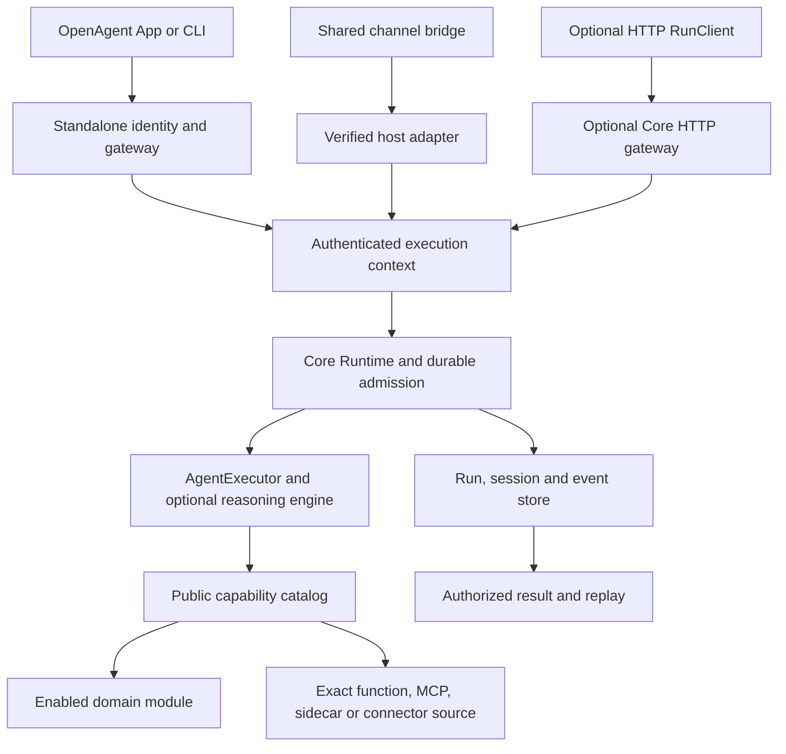

# Components and communication

OpenAgent has three independently versioned repositories. Read
[agnostic architecture](agnosticism.md) first: shared mechanisms are generic;
embedding-product names, branches and business rules do not belong in OpenAgent.

| Repository | Components | Public integration |
| --- | --- | --- |
| `openagent-core` | Kernel/runtime, optional reasoning engine and modules, SQLite store, optional HTTP gateway, Python/TypeScript SDK, engine-free capability host | Explicit settings, verified ExecutionContext, Runtime services/profile and capability contracts |
| `openagent-tools` | Tool protocol, filesystem/editor/shell/search, process execution, native/browser sidecars, connector SDK/runner/auth broker | Direct Python call, registered source, MCP or bound connector operation |
| `openagent` | Standalone server, shared App renderer/Electron shell, CLI, MCP bridge, identity, transport, channels, dashboards and packaging | Standalone identity/gateway/client protocols and shared versioned packages |

## How a turn runs

The kernel admits and supervises work; the optional engine reasons over it.
The server composes those layers. Clients display and steer the same durable
execution; they do not own another model loop. A tool runner or native/browser
sidecar executes capabilities and is not an agent engine. A channel translates
provider conversation events, while a connector exposes a provider API as tools.
MCP bridge connects MCP clients to configured agents; it is neither of those.

An embedding host may call Runtime directly and omit every standalone component.
It owns authentication, business permissions, deployment and data adapters;
Core owns generic execution semantics. The optional HTTP run gateway and SDK
do not imply compatibility with the standalone Iroh identity protocol.

## State, modules and device capabilities

`RuntimeSettings` supplies an explicit agent workspace. `RuntimeServices`
supplies a store, executor and authorizer. `RuntimeProfile` activates installed
module descriptors/surfaces; installation alone activates nothing. Sessions have
a mandatory kernel storage substrate and optional administration tools. Vault,
MCP, Search, Scheduler, Workflows and other module surfaces are independently selected.

Capabilities bind exact source, actor, audience and generation; calls use opaque
tool references. A connected App's local computer/dashboard grant applies only
to its authenticated originating context, not to a channel or scheduled task.
Server-owned tools are separate explicitly registered sources. Revocation and
publication recheck current authority. A network acknowledgement is not a
terminal result; reconcile run identity and replay cursor instead of duplicating effects.

## Organization and practical use

- [Core map](https://github.com/openagent-uno/openagent-core/blob/main/docs/COMPONENTS.md)
  and [Core usage](https://github.com/openagent-uno/openagent-core/blob/main/docs/USAGE.md):
  kernel versus engine, modules, store, HTTP gateway/SDK and executable local demo.
- [Tools map](https://github.com/openagent-uno/openagent-tools/blob/main/docs/COMPONENTS.md)
  and [Tools usage](https://github.com/openagent-uno/openagent-tools/blob/main/docs/USAGE.md):
  package ownership, direct/MCP use, execution backends, sidecars and connector runner.
- [Standalone map](https://github.com/openagent-uno/openagent/blob/main/docs/COMPONENTS.md)
  and [standalone usage](https://github.com/openagent-uno/openagent/blob/main/docs/USAGE.md):
  exact component paths, commands, App/CLI/server/bridge and packaging.
- [Getting started](getting-started.md), [client capabilities](client-capabilities.md),
  [shared components](shared-components.md) and [embedded channels](embedded-channels.md)
  provide the detailed product/protocol instructions.

## Where a fix belongs

Fix generic runtime behavior in Core, tool execution behavior in Tools, and
standalone composition/UI/channel transport in the owning OpenAgent package.
Extend the generic public contract if necessary and let consumers adopt a
versioned capability. Never make the reporting application's identity a feature
selector or replace the shared implementation with a consumer-local patch.
