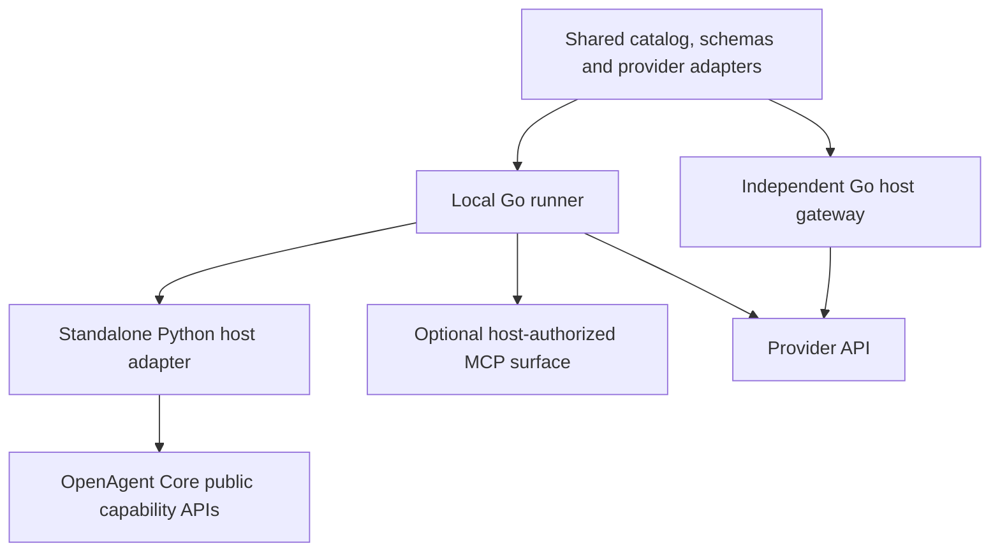
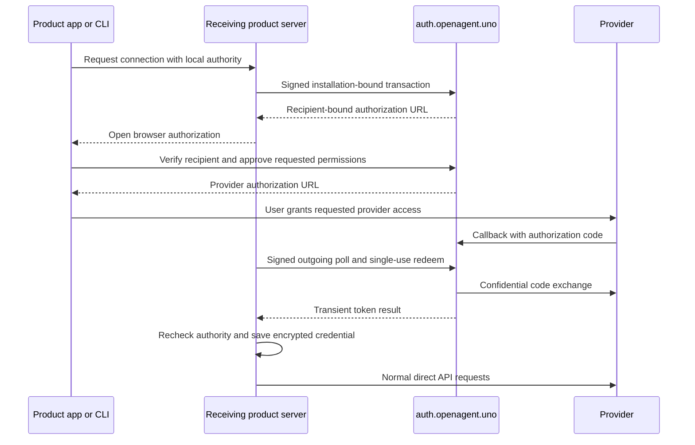

# Shared components and connector architecture

OpenAgent shares implementations across products while each product owns its
accounts, authorization and persistent data. Each standalone or independently
embedded installation keeps its own accounts; it does not become an account on
a central OpenAgent agent server. The common OAuth service is an optional dependency for common provider
apps; it is not the authority for the agent network or product users.

For the current qualification and remaining work, see
[Connector release status](./connector-status.md). For end-user actions, see
[Using connectors](./connectors.md).

For composing applications over several accounts or sources, see
[Composable applications](./application-composition.md). Shared provider
adapters supply operations; application state, projections, interactive views
and synchronization remain explicit host service contracts. A connector card
or a successful OAuth connection does not establish those application features.

## What is shared

| Component | Owner | Consuming products |
| --- | --- | --- |
| Runtime, sessions, runs, module services and uniform capability contracts | OpenAgent Core | Standalone and embedding products |
| Filesystem, editor, shell, web search, computer and browser implementations | OpenAgent Tools | Server or authenticated client capability hosts |
| Official connector catalog, operation schemas, provider adapters, scope checks, pagination and permitted retry logic | OpenAgent Tools `packages/connectors` | Go embedding hosts as a dependency; standalone through a local runner |
| Local connector runner and Python/MCP transport adapter | OpenAgent Tools | Python hosts and products exposing a connector through MCP |
| OAuth app exchange, secret-dependent renewal and Shopify coordination | Separately deployed `connector-auth` | Explicitly configured receiving installations |
| Accounts, tenants, grants, credential storage, audit, local privacy actions and UI | Each product | Its own installation and users |

Current published product components are **server/CLI beta51, Core beta22 and Host Tools 1.0.0b6**. Independently published **connector SDK/runner 0.1.12** preserves **114 official connectors plus Custom MCP**, with 315 reads and 82 actions. A host must explicitly adopt and qualify a new component; publishing the SDK does not update an installed server.

The 90 manual-token profiles introduced in SDK 0.1.8 have two specific reads each. OneDrive/SharePoint remain read-only with server-verified account/site/drive bindings. Vendor permissions are setup requirements enforced by each provider. Token connections do not attest OAuth scopes or promise automatic token renewal. Code and documented-response fixtures do not establish real-account acceptance.

Go hosts can pin
`github.com/openagent-uno/openagent-tools/packages/connectors@v0.1.12`. The module Git tag is `packages/connectors/v0.1.12`; the independently versioned runner release is [connectors-v0.1.12](https://github.com/openagent-uno/openagent-tools/releases/tag/connectors-v0.1.12). Public [server/CLI51](https://github.com/openagent-uno/openagent/releases/tag/v1.1.0-beta.51) explicitly adopts SDK 0.1.12 and native Shopify receipt v2. Each host qualifies its credential storage, scope policy, receipt capabilities and deployment; component publication never attests data-processing coverage.

**App beta22 is public.** Its [actual Linux x64 App22/server45 marketplace trial](https://github.com/openagent-uno/openagent/blob/main/docs/qualification/app22-server45-marketplace-2026-10-18.json) verified 114 official entries, 30 registry results, shared marks and blank token setup. This is the dated GUI boundary; it is not a claim about a newer server pair or every provider. Earlier App21/server44 and SDK 0.1.7 receipts below retain their original versions and counts.

The Calendar/mail adapters introduced in SDK17 bind each account to its own local connection. Google sync
checkpoints and Graph page cursors do not become shared application state:
hosts persist projections/checkpoints, resolve 410 resets and 412 version
conflicts, and implement synchronization explicitly. The adapters perform one
HTTP attempt and do not replay an uncertain write. They add no calendar UI,
mail client or required application service. See [operation limits](./connector-operations.md#calendar-and-mail-sdk-017).

The qualified boundaries are separate:

- [App21/server44 Linux x64 marketplace](https://github.com/openagent-uno/openagent/blob/main/docs/qualification/app21-server44-marketplace-2026-10-17.json): 22 official entries and 30 registry results, 12 loaded local marks, five keyless local control cycles and seven original images plus three supplementary files (two unique views) showing the Calendar/Outlook cards; zero GUI provider calls/models. Exact owned cleanup and worker deletion passed.
- [SDK 0.1.6](https://github.com/openagent-uno/openagent/blob/main/docs/qualification/keyless-sdk-0.1.6-2026-10-17.json): race/vet/vulnerability checks, six-target packaging, Python/native smoke and six limited real runner reads for Parallel, Context7 and CoinGecko. Cross-compilation is not execution on every target.
- [Server 43 installed fixtures](https://github.com/openagent-uno/openagent/blob/main/docs/qualification/product43-installed-2026-10-17.json) and [normal public installer](https://github.com/openagent-uno/openagent/blob/main/docs/qualification/product43-public-installer-2026-10-17.json): 157 installed tests, explicit source/acquisition guards and ordinary pinned installation.
- [Normal server 43 workflows](https://github.com/openagent-uno/openagent/blob/main/docs/qualification/keyless-product-1.1.0b43-2026-10-17.json): three connections, six reads across an actual restart, local tombstones/source removal and owned cleanup. Workflow-result metrics are distinct from provider HTTP telemetry.
- [App beta 20 native release](https://github.com/openagent-uno/openagent/blob/main/docs/qualification/app20-native-release-2026-10-17.json) and [Linux x64 GUI](https://github.com/openagent-uno/openagent/blob/main/docs/qualification/app20-server43-marketplace-2026-10-17.json): six native targets; 19 official entries with 30 registry results in one grid, nine marks, five local control cycles and seven reviewed images. GUI provider calls were zero; hosted `--no-sandbox` does not qualify sandbox security or Mac/Windows marketplace GUI.

Exa/Firecrawl real-provider evidence remains in the historical
[SDK 0.1.5](https://github.com/openagent-uno/openagent/blob/main/docs/qualification/keyless-sdk-0.1.5-2026-10-17.json) and
[server 41](https://github.com/openagent-uno/openagent/blob/main/docs/qualification/keyless-product-1.1.0b41-2026-10-17.json)
receipts. [App beta 19/server 42](https://github.com/openagent-uno/openagent/blob/main/docs/qualification/app19-server42-marketplace-2026-10-17.json)
and [App beta 18/server 40](https://github.com/openagent-uno/openagent/blob/main/docs/qualification/app18-server40-marketplace-2026-10-16.json)
retain their original counts, screenshots and failures.

The independently published [auth-only 0.1.7](https://github.com/openagent-uno/openagent-tools/releases/tag/connector-auth-v0.1.7)
service adds conservative Shopify acquisition-history guards; it does not publish
a new SDK or runner. Its source is `7f6856f9`, with 96 unit and 96 race checks,
vet and the recorded image scan passing. The earlier 0.1.6 service's Slack
refresh correction remains in the release history. Publication and production
image adoption are separate checkpoints in [release status](./connector-status.md).
Each receiving host authorizes local access and every OAuth connection requires
provider consent. Provider and general-enrollment gates remain independent.

A keyless connector still has an authorized connection and tool source. Only a
reviewed no-auth adapter accepts explicit `{"kind":"none"}`; an omitted token
never downgrades another provider. Fixed endpoints and tools remain in the
adapter; owner/tenant grants, storage, enable/disable, disconnection and audit
remain with the host. No provider token, refresh or broker exchange is needed.
Current server defaults are ClickUp, GitHub, Notion, Outlook Mail/Calendar, OneDrive and Slack only when both operator settings are absent. Historical server43 defaulted to three profiles. Explicit empty settings stay disabled and no default creates a grant or automatic broker registration. Fresh keyless-only
servers do not poll the broker. See [configuration precedence](./connector-operations.md#standalone-configuration).

Existing catalog IDs and tool names are preserved. Adding a shared adapter
must update its catalog entry, schemas, operation implementation and tests;
each product then consumes an explicitly pinned version. A catalog placeholder
without implemented tools remains unavailable.

## Core capabilities, tools, MCPs and connectors

A **tool** is an operation exposed through the Core capability catalog. A
**source** binds those operations to an executor and an authorized destination.
A **connector** implements a provider integration. **MCP** is a transport for
external tool servers. These are related concepts, not interchangeable package
types.

Core modules can expose native tools without an MCP process. A connector may
be called through a Go host adapter or a local Python capability source; an MCP
surface is available when a consuming host needs that protocol. The same
provider logic is used in either case. Sharing a connector does not require
routing every request through a remote shared MCP server.

External registry MCPs remain a separate implementation path even when their
cards appear in the same marketplace. Their endpoints, runtimes and trust
review belong to the receiving product. A public registry listing or an
operator-supplied product name is not an OpenAgent endorsement.

Embedding hosts supply their own identity and workspace/project policy.
The standalone supplies a verified network/device principal and registers
`OfficialConnectorSource` through Core's public catalog API. Core does not
import provider app secrets, product accounts or the broker implementation.
Trusted runner IPC carries credentials separately from model tool arguments;
it is not an unauthenticated network API.

### Register managed sources before run admission

Core beta22 captures the capability catalog revision when a new run is admitted.
A host must register its trusted managed-source topology before calling public
`Runtime.submit` or `Runtime.execute_operation`. Preparation uses the host's
verified actor, session and workspace binding, rechecks current authorization
across the awaited snapshot, and registers source identities without provider
I/O, tool execution or an execution grant. An unchanged topology must remain
idempotent. A source added after admission stays outside that run's captured
revision; a later newly admitted run can see it. Do not backdate registrations
or weaken the revision, module-generation or lease checks.

Management inspection remains schema-only: it does not register executable
sources or issue executable references. Saved workflows retain the exact source
and tool binding, not a cached opaque `ToolRef` as durable authority. At execution,
resolve that exact binding in the current authorized catalog and use its fresh
reference; never substitute another source or bypass the catalog through a raw
MCP pool. Discovery and every call still recheck current host policy, connection,
actor and result audience, including revocation after preparation. A prepared
registration is neither permission to call nor a reusable cross-actor snapshot.

This explains the existing Core beta22 admission contract. Each host's
implementation and remote workflow acceptance require their own qualification;
this documentation change establishes no new execution or provider acceptance.
The calendar, task and file examples in [Composable applications](./application-composition.md)
remain architectural acceptance cases rather than newly delivered features.

## Data and authorization boundaries

The host supplies a connection binding, current credential, operation ID and
audit. It checks local authority before saving an OAuth result and again at
operation admission. The adapter enforces supported tool names, granted scopes,
read/write gates and provider-specific request rules. A model argument cannot
select another installation, owner, token or computer.

In the standalone, connector tools are bound to the initiating principal,
tenant and permitted result audience. In embedded host products, existing
membership, connection/installation identity, project scope and agent grants
remain authoritative. Sharing code never merges those permission systems.

Catalog visibility and usable host integration are separate. OneDrive/SharePoint also require authenticated account discovery and verified site/drive selection in the receiving host. A provider allowlist cannot replace those routes or their account-change guards. Hosts must retain an unavailable state until those bindings are implemented and qualified; accepting arbitrary model-supplied identifiers or a generic token bypass is not a substitute.

Normal Gmail, Drive, task, shop and other provider requests originate from the
receiving product server. The broker performs confidential authentication
exchanges and a minimal Shopify shop-identity check. It does not proxy normal
provider contents. Connected data may still enter the product's transcripts,
files, Vault or configured model-provider requests; the product must govern
those destinations. See [Privacy](../privacy.md).

## Common OAuth without public local callbacks

Installations keep persistent Ed25519 signing and X25519 encryption keys.
Requests bind method, path/query, body, time and nonce. Transactions bind the
installation, provider and requested permissions, expire and can be redeemed
only once. The consent page identifies the receiving product/name and
cryptographic installation ID. Third-party installations use the same
versioned protocol and limits without receiving an approval badge.

The broker permanently stores identity/authorization metadata, keyed token
fingerprints, Shopify group generations and an encrypted minimized event queue.
It does not permanently store access tokens, refresh tokens, codes or
installation private keys. Tokens are transient during exchange and renewal.
Temporary peer token envelopes expire within ten minutes and are not a durable
central credential archive.

Own OAuth apps remain supported. Locally valid tokens and token-authenticated
connectors continue during a broker outage; new common consents and renewals
requiring the central app secret cannot complete during that outage.

## Shopify: one app and shop, several recipients

Shopify token acquisition and renewal must be coordinated for the same app and
shop; issuing a token concurrently can retire another operation's result.
The shared broker serializes both and tracks the current generation. The
requesting server atomically stores the entire replacement pair, commits its
checkpoint and sends a separately encrypted envelope to each authorized peer.
These constraints follow [Shopify's token lifecycle](https://shopify.dev/docs/apps/build/authentication-authorization/access-tokens).

Every additional server must obtain verified Shopify consent and explicit
recipient authorization. The broker verifies numeric shop identity; a shop
name in an unsigned routing header is not sufficient. Each server keeps its
own tool permissions. A peer that missed an envelope asks a current peer for
a copy through outgoing polling; if no current copy is recoverable, it requires
fresh consent rather than reusing an uncertain credential.

Privacy and uninstall notifications enter a durable queue with verification,
deduplication, acknowledgments and retry. Products perform their own export and
redaction. Acknowledging durable receipt is not proof that local privacy work
has finished. The compatibility outbox can relay notifications to a legacy
host processor during migration. The existing approved app's four routes were
cut over on 19 October; the genuine QA uninstall received one acknowledged
legacy delivery. That acknowledgement does not attest native processing or
complete erasure. Standalone beta 39 qualified an opt-in worker for a fresh
canonical text-history cohort; historical content and other enabled storage
surfaces still require qualification. Common Shopify enrollment remains
disabled. See [release gates](./connector-status.md).

### Authenticated privacy generations

SDK 0.1.12 introduces an explicit version-two receipt contract. A receiving host must request `receipt_version=2` at Shopify authorization and event polling; updating the runner alone does not claim host support. The receipt retains the original provider occurrence time and a separately authenticated authorization cutoff. A delayed `shop/redact` is bound to an eligible verified prior uninstall only when that history identifies exactly one candidate. Missing or ambiguous history remains durable and pending; neither the local receive time nor a guessed ordering can authorize erasure.

The host must use the authenticated cutoff for credential revocation and its local content-generation fence, preserving a later new consent. It saves the complete encrypted receipt before acknowledging delivery and validates duplicates against that receipt. An old host requesting version one cannot receive and acknowledge a redaction it cannot process safely. Legacy full receipts without the new authenticated metadata stay blocked; they are not silently upgraded.

A compatibility relay authenticates its fresh delivery time, exact configured receiving URL, topic, provider webhook identity/version and body digest, while retaining the immutable original occurrence time and provider body HMAC. A receiving product must independently qualify that relay and its local data processing. Once version-two events are persisted, an older broker that ignores their cutoff is not a safe rollback: keep the compatible broker and pause new consents while correcting routes or configuration.

Auth service 0.1.7 also records successful authorization acquisition separately
from refresh. A verified uninstall that may predate an unobserved or uncertain
acquisition stays durable and pending; it cannot revoke a provably newer grant
or be relayed as if its generation were established. Historical groups without
that acquisition evidence are not backfilled by guessing. After the new durable
fields are written, keep service 0.1.7 or a compatible successor paused for
repair; an earlier broker or old-state restore is not a valid downgrade.

These are published protocol and implementation contracts. Their deployed image, receiving product and actual provider cutover remain separately recorded in [release status](./connector-status.md).

Existing credentials keep their issuing OAuth app. They are not silently
reassigned. Shopify can retire credentials during a later acquisition or
migration, so the rollout must coordinate remaining legacy token issuers and
recipient reconnection; old tokens are not promised indefinite validity.
See [Shopify's migration requirements](https://shopify.dev/docs/apps/build/authentication-authorization/migrate-to-expiring-offline-access-tokens).

A receiving product must fence all direct token acquisition and renewal paths for the exact app before handing issuance to the broker, including embedded session exchange, pending callbacks and background refresh. Drain in-flight work before activation. Keep other app registrations and existing grants distinct; never infer the emitting app from a matching catalog ID. Native adoption also requires durable storage of the full v2 receipt and its original cutoff/pair. Until both transitions are qualified, keep new shared-app admissions paused; the compatibility webhook relay alone does not establish that handoff.

## Privacy processing still required

The current standalone inbox is only the delivery boundary. Completing privacy
processing requires trusted lineage from a connection/result into transcripts,
compacted history, delegated sessions, Vault notes, attachments and generated
files. Provenance must remain bound to the authorized tenant and provider
account; model-supplied labels cannot authorize a privacy action.

The beta 39 inbox persists the complete broker receipt encrypted, including
group/topic and occurrence timestamps, before acknowledging delivery. This
preserves the generation fence across restart and duplicate delivery. Historical
payload-only receipts retain an explicit older format; missing metadata is
never inferred from the local receive time. These storage guarantees do not
complete a privacy request or enable Shopify enrollment.

The host needs durable, idempotent jobs for the verified provider request,
bounded export/redaction, admission fences while affected work is running,
and completion receipts. [Core beta 22](https://github.com/openagent-uno/openagent-core/releases/tag/v1.1.0-beta.22)
publishes reusable content/provenance contracts through public services. Its
installed-wheel qualification covers a fresh, canonical text-history cohort,
including selected records, derived history, compaction and child sessions.
The receiving product interprets Shopify events, selects the verified
customer/store and binds its own qualified storage surfaces before runtime
startup. Unqualified historical content, backups, media, Vault/files or custom
callbacks keep processing blocked. Publishing Core does not qualify a host
adapter or migrate existing data. Clearing a token or acknowledging a webhook
cannot substitute for completing local privacy jobs.

Standalone processing requires the strict boolean opt-in
`connectors.privacy.enabled=true`. Coverage is computed from the actual
NativeProvider/ModelDispatcher, exact canonical dashboard content validator,
baseline history audit and public sinks registered before startup/recovery and
connector publication. A `covered_surfaces` configuration field is rejected;
an operator or model cannot declare an unsupported callback or storage surface
qualified. The published API exposes provenance, fences and processing jobs;
provider event mapping, authorized export destinations and the runtime/storage
assembly remain host-owned. Text-only qualification does not enable common
Shopify or establish real-provider consent and two-server rotation acceptance.

## Shared code and product UI

The standalone marketplace uses one card component and one responsive grid for
provider integrations and registry MCPs. Official entries have the official provider
marks, without a dedicated tab, heading, label or
divider. The original logo assets and their source hashes are bundled locally.
They are currently packaged by each client, rather than fetched from a central
runtime UI service.

Host management screens and permission controls remain product code. The
shared library is not a shared React application, shared database or global
MCP credential store. Core exposes public contracts; products build their
surfaces from those contracts without engine forks or installation overlays.

### Remote MCP authentication: remaining work

The current MCP configuration's `oauth` flag is stored but is not connected to
an OAuth client in the HTTP transport. Turning it on does not start a complete
browser authorization flow. Static MCP headers are configuration returned to
authorized catalog readers; they are not the credential store for new personal
OAuth connections. Ordinary mutable MCP sources also do not carry the
per-connection owner binding used by official connector grants.

Adding authenticated official remote MCPs therefore needs one reusable managed
source per connection: locally encrypted OAuth/client-registration state,
an authenticated browser callback bound to its owner and installation, and
tenant/owner/audience/generation checks before tool calls and credential saves.
Public catalog responses expose connection state and tool descriptions, without
tokens. The host can register that source through Core's public capability APIs;
provider-specific API adapters need not be duplicated. Generic pool support can
then accept host-supplied HTTP authentication through a public hook.

For example, [Supabase's official MCP](https://supabase.com/docs/guides/ai-tools/mcp)
supports dynamic client registration without a manually created app or PAT, with
project and read-only restrictions. [Firecrawl documents an OAuth MCP endpoint](https://docs.firecrawl.dev/mcp-server/oauth);
its registration and callback compatibility still need qualification. Neither
integration is marked ready by this architecture note. Transport authentication,
consent, owner isolation, refresh/restart and supported elicitation behavior must
be verified before a card offers authenticated use.

## Operational limits

The first broker deployment is one writer, one metadata volume and a `Recreate`
rollout. It cannot be scaled by adding replicas against the same state file.
High availability requires a transactional store and distributed coordination
before multiple writers are admitted. Native runtime/signing qualification,
production secret storage, provider reviews and real product acceptance remain
separate from library unit tests and cross-compilation.

See [operator setup and recovery](./connector-operations.md) for configuration,
backup boundaries, API contracts and troubleshooting.
