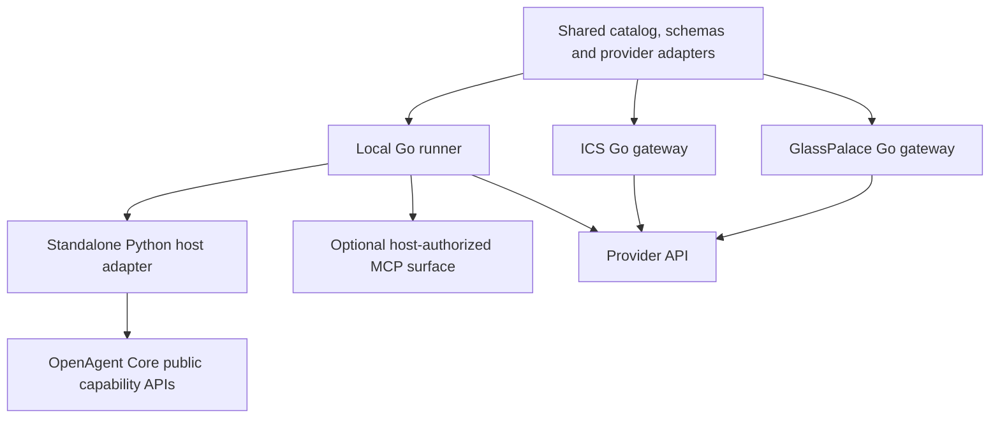
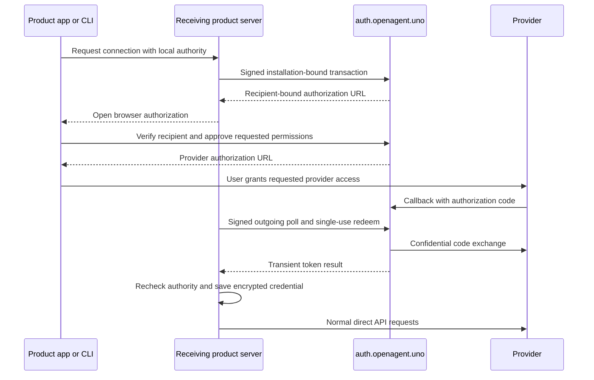

# Shared components and connector architecture

OpenAgent shares implementations across products while each product owns its
accounts, authorization and persistent data. An installation of GlassPalace,
ICS or the standalone does not become an account on a central OpenAgent agent
server. The common OAuth service is an optional dependency for common provider
apps; it is not the authority for the agent network or product users.

For the current qualification and remaining work, see
[Connector release status](./connector-status.md). For end-user actions, see
[Using connectors](./connectors.md).

## What is shared

| Component | Owner | Consuming products |
| --- | --- | --- |
| Runtime, sessions, runs, module services and uniform capability contracts | OpenAgent Core | Standalone and embedding products |
| Filesystem, editor, shell, web search, computer and browser implementations | OpenAgent Tools | Server or authenticated client capability hosts |
| Official connector catalog, operation schemas, provider adapters, scope checks, pagination and permitted retry logic | OpenAgent Tools `packages/connectors` | GlassPalace and ICS as a Go dependency; standalone through a local runner |
| Local connector runner and Python/MCP transport adapter | OpenAgent Tools | Python hosts and products exposing a connector through MCP |
| OAuth app exchange, secret-dependent renewal and Shopify coordination | Separately deployed `connector-auth` | Explicitly configured receiving installations |
| Accounts, tenants, grants, credential storage, audit, local privacy actions and UI | Each product | Its own installation and users |

The shared connector release is `0.1.2`, with Go module tag
`packages/connectors/v0.1.2` and runner release `connectors-v0.1.2`.
[Source and contract](https://github.com/openagent-uno/openagent-tools/tree/connectors-v0.1.2/packages/connectors)
and [platform artifacts](https://github.com/openagent-uno/openagent-tools/releases/tag/connectors-v0.1.2)
are independently versioned from the standalone product. The platform release
is a qualification prerelease, not native signing or provider acceptance.
Its `qualification.json` records the tested boundaries alongside the source,
platform manifests and checksums. The deployed broker is independently released
as [auth-only 0.1.3](https://github.com/openagent-uno/openagent-tools/releases/tag/connector-auth-v0.1.3).
This does not change module/runner 0.1.2 or enable public provider enrollment;
ClickUp is restricted to two allowlisted QA installation identities.

Existing catalog IDs and tool names are preserved. Adding a shared adapter
must update its catalog entry, schemas, operation implementation and tests;
each product then consumes an explicitly pinned version. A catalog placeholder
without implemented tools remains unavailable.

## Core capabilities, tools, MCPs and connectors

A **tool** is an operation exposed through the Core capability catalog. A
**source** binds those operations to an executor and an authorized destination.
A **connector** implements a provider integration. **MCP** is a transport for
external tool servers. These are related concepts, not interchangeable package
types.

Core modules can expose native tools without an MCP process. A connector may
be called through a Go host adapter or a local Python capability source; an MCP
surface is available when a consuming host needs that protocol. The same
provider logic is used in either case. Sharing a connector does not require
routing every request through a remote shared MCP server.

External registry MCPs remain a separate implementation path even when their
cards appear in the same marketplace. Their endpoints, runtimes and trust
review belong to the receiving product. A public registry listing or an
operator-supplied product name is not an OpenAgent endorsement.

GlassPalace and ICS supply their own identity and workspace/project policy.
The standalone supplies a verified network/device principal and registers
`OfficialConnectorSource` through Core's public catalog API. Core does not
import provider app secrets, product accounts or the broker implementation.
Trusted runner IPC carries credentials separately from model tool arguments;
it is not an unauthenticated network API.

## Data and authorization boundaries

The host supplies a connection binding, current credential, operation ID and
audit. It checks local authority before saving an OAuth result and again at
operation admission. The adapter enforces supported tool names, granted scopes,
read/write gates and provider-specific request rules. A model argument cannot
select another installation, owner, token or computer.

In the standalone, connector tools are bound to the initiating principal,
tenant and permitted result audience. In GlassPalace and ICS, existing
membership, connection/installation identity, project scope and agent grants
remain authoritative. Sharing code never merges those permission systems.

Normal Gmail, Drive, task, shop and other provider requests originate from the
receiving product server. The broker performs confidential authentication
exchanges and a minimal Shopify shop-identity check. It does not proxy normal
provider contents. Connected data may still enter the product's transcripts,
files, Vault or configured model-provider requests; the product must govern
those destinations. See [Privacy](../privacy.md).

## Common OAuth without public local callbacks

Installations keep persistent Ed25519 signing and X25519 encryption keys.
Requests bind method, path/query, body, time and nonce. Transactions bind the
installation, provider and requested permissions, expire and can be redeemed
only once. The consent page identifies the receiving product/name and
cryptographic installation ID. Third-party installations use the same
versioned protocol and limits without receiving an approval badge.

The broker permanently stores identity/authorization metadata, keyed token
fingerprints, Shopify group generations and an encrypted minimized event queue.
It does not permanently store access tokens, refresh tokens, codes or
installation private keys. Tokens are transient during exchange and renewal.
Temporary peer token envelopes expire within ten minutes and are not a durable
central credential archive.

Own OAuth apps remain supported. Locally valid tokens and token-authenticated
connectors continue during a broker outage; new common consents and renewals
requiring the central app secret cannot complete during that outage.

## Shopify: one app and shop, several recipients

Shopify token acquisition and renewal must be coordinated for the same app and
shop; issuing a token concurrently can retire another operation's result.
The shared broker serializes both and tracks the current generation. The
requesting server atomically stores the entire replacement pair, commits its
checkpoint and sends a separately encrypted envelope to each authorized peer.
These constraints follow [Shopify's token lifecycle](https://shopify.dev/docs/apps/build/authentication-authorization/access-tokens).

Every additional server must obtain verified Shopify consent and explicit
recipient authorization. The broker verifies numeric shop identity; a shop
name in an unsigned routing header is not sufficient. Each server keeps its
own tool permissions. A peer that missed an envelope asks a current peer for
a copy through outgoing polling; if no current copy is recoverable, it requires
fresh consent rather than reusing an uncertain credential.

Privacy and uninstall notifications enter a durable queue with verification,
deduplication, acknowledgments and retry. Products perform their own export and
redaction. Acknowledging durable receipt is not proof that local privacy work
has finished. The compatibility outbox can relay notifications to the legacy
GlassPalace processor during migration, but that relay has not been activated
in production. The standalone's content export/redaction worker is unfinished
and blocks its Shopify enrollment. See [release gates](./connector-status.md).

Existing credentials keep their issuing OAuth app. They are not silently
reassigned. Shopify can retire credentials during a later acquisition or
migration, so the rollout must coordinate remaining legacy token issuers and
recipient reconnection; old tokens are not promised indefinite validity.
See [Shopify's migration requirements](https://shopify.dev/docs/apps/build/authentication-authorization/migrate-to-expiring-offline-access-tokens).

## Privacy processing still required

The current standalone inbox is only the delivery boundary. Completing privacy
processing requires trusted lineage from a connection/result into transcripts,
compacted history, delegated sessions, Vault notes, attachments and generated
files. Provenance must remain bound to the authorized tenant and provider
account; model-supplied labels cannot authorize a privacy action.

The candidate inbox persists the complete broker receipt encrypted, including
group/topic and occurrence timestamps, before acknowledging delivery. This
preserves the generation fence across restart and duplicate delivery. Historical
payload-only receipts retain an explicit older format; missing metadata is
never inferred from the local receive time. These storage guarantees do not
complete a privacy request or enable Shopify enrollment.

The host needs durable, idempotent jobs for the verified provider request,
bounded export/redaction, admission fences while affected work is running,
and completion receipts. Reusable content/provenance contracts belong upstream
in Core's public services; Shopify event interpretation and customer/store
selection belong to the receiving product. This integration is unfinished.
Clearing a token or acknowledging a webhook cannot substitute for it.

## Shared code and product UI

The standalone marketplace uses one card component and one responsive grid for
provider integrations and registry MCPs. Official entries have the provider
marks used in GlassPalace/ICS, without a dedicated tab, heading, label or
divider. The original logo assets and their source hashes are bundled locally.
They are currently packaged by each client, rather than fetched from a central
runtime UI service.

Host management screens and permission controls remain product code. The
shared library is not a shared React application, shared database or global
MCP credential store. Core exposes public contracts; products build their
surfaces from those contracts without engine forks or installation overlays.

## Operational limits

The first broker deployment is one writer, one metadata volume and a `Recreate`
rollout. It cannot be scaled by adding replicas against the same state file.
High availability requires a transactional store and distributed coordination
before multiple writers are admitted. Native runtime/signing qualification,
production secret storage, provider reviews and real product acceptance remain
separate from library unit tests and cross-compilation.

See [operator setup and recovery](./connector-operations.md) for configuration,
backup boundaries, API contracts and troubleshooting.
